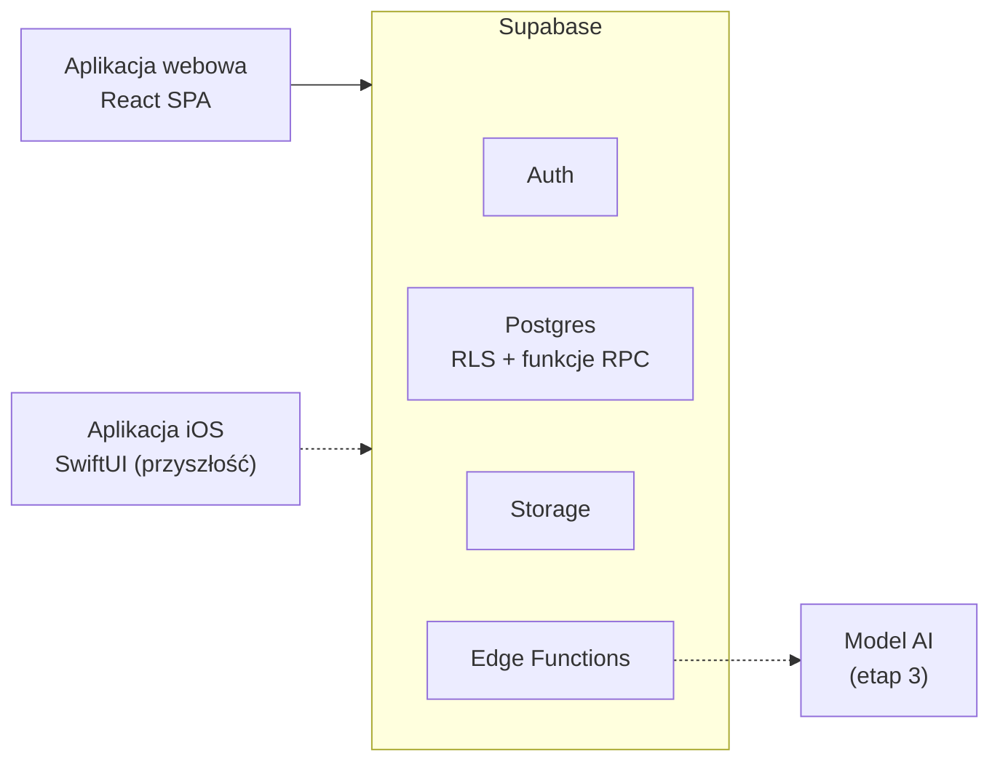

# Koperty (nazwa robocza)

Aplikacja webowa do zarządzania domowym budżetem metodą kopertową. Obsługuje wiele niezależnych budżetów domowych, a każdy budżet może być prowadzony wspólnie przez kilka osób (np. przez małżeństwo).

> **Status:** faza 0, przygotowanie fundamentów projektu. Projekt realizowany w ramach kursu AI SDLC: aplikacja jest budowana z intensywnym wykorzystaniem agentów AI na każdym etapie cyklu wytwarzania oprogramowania.

## Problem i cel

Metoda kopertowa polega na tym, że każda złotówka dochodu dostaje swoje zadanie: trafia do konkretnej koperty (np. „Jedzenie”, „Rachunki”, „Wakacje”). Wydatki są zdejmowane z kopert, dzięki czemu w każdej chwili widać, ile zostało na dany cel.

Cele aplikacji:

- prowadzenie budżetu metodą kopertową w wygodnym, nowoczesnym interfejsie,
- wspólne prowadzenie jednego budżetu przez kilka osób na tych samych danych,
- obsługa wielu niezależnych budżetów w jednej instancji aplikacji, z pełną izolacją danych między nimi,
- w przyszłości: automatyczne rozpoznawanie paragonów i faktur oraz natywna aplikacja na iOS.

## Słownik domenowy

Dokumentacja i interfejs są po polsku, kod po angielsku. Poniższe nazwy obowiązują w całym projekcie.

| Pojęcie (PL) | Nazwa w kodzie (EN) | Znaczenie |
|---|---|---|
| Budżet | `budget` | Wspólna przestrzeń danych jednego gospodarstwa domowego. |
| Członek budżetu | `budget_member` | Użytkownik z dostępem do budżetu i przypisaną rolą. |
| Zaproszenie | `invitation` | Sposób dołączenia nowej osoby do istniejącego budżetu. |
| Koperta | `envelope` | Cel wydatków, do którego przydziela się środki. |
| Okres | `period` | Miesiąc rozliczeniowy. |
| Przychód | `income` | Wpływ środków, który zwiększa pulę do rozdysponowania. |
| Do rozdysponowania | `unallocated` | Środki, które nie zostały jeszcze przydzielone do kopert. |
| Przydział | `allocation` | Przypisanie kwoty z puli do koperty w danym okresie. |
| Wydatek | `expense` | Transakcja zmniejszająca saldo jednej lub kilku kopert. |
| Podział wydatku | `expense_split` | Część wydatku przypisana do konkretnej koperty. |
| Przesunięcie | `envelope_transfer` | Przeniesienie środków między kopertami. |

## Etapy rozwoju

1. **MVP (web):** konta użytkowników, budżety i zaproszenia, koperty, przychody i ich rozdział, wydatki z podziałem na koperty, podsumowanie miesiąca, wdrożenie jako PWA.
2. **Rozszerzenia:** przesunięcia między kopertami, zwrot niewykorzystanej reszty z koperty do puli na koniec miesiąca, wydatki cykliczne, wykresy i historia.
3. **AI:** analiza zdjęć paragonów i faktur oraz propozycja koperty lub podziału, zatwierdzana przez użytkownika.
4. **Mobile:** natywna aplikacja na iOS (Android jako opcja), korzystająca z tego samego backendu.

Szczegółowy zakres MVP opisuje [docs/prd.md](docs/prd.md).

## Architektura

Backend jest niezależny od klienta. Aplikacja webowa jest pierwszym klientem, a natywna aplikacja na iOS będzie kolejnym, równorzędnym klientem tych samych danych i reguł.



Najważniejsze zasady:

- **Logika biznesowa żyje w backendzie.** Reguły kopert, salda i przydziały są realizowane w bazie (funkcje Postgresa wywoływane przez RPC, ograniczenia, RLS) lub w Edge Functions. Klienci tylko je wywołują.
- **Izolacja danych przez RLS.** Wszystkie dane budżetu są powiązane z `budget_id`, a reguły Row Level Security dopuszczają wyłącznie członków danego budżetu.
- **Kwoty jako liczby całkowite w groszach.** Nigdy jako liczby zmiennoprzecinkowe.
- **Schemat bazy jest kontraktem.** Migracje są wersjonowane w repozytorium, a zmiany muszą być wstecznie zgodne, bo w przyszłości będą z nich korzystać także starsze wersje aplikacji mobilnej.

Szczegóły i uzasadnienia decyzji: [docs/architecture.md](docs/architecture.md) oraz [docs/adr/](docs/adr/).

## Stack technologiczny

**Aplikacja webowa**

- React + TypeScript (SPA, bez renderowania po stronie serwera)
- [Vite+](https://viteplus.dev): Vite 8, Vitest, Oxlint, Oxfmt w jednym narzędziu (`vp`)
- [Bun](https://bun.sh) jako menedżer pakietów (wywoływany przez komendy `vp`)
- TanStack Router (routing) i TanStack Query (dane z backendu)
- Tailwind CSS i shadcn/ui
- PWA jako tymczasowy sposób korzystania z aplikacji na telefonie

**Backend**

- Supabase: Postgres, Auth, Row Level Security, Storage, Edge Functions
- Supabase CLI: lokalne środowisko, migracje, generowanie typów
- pgTAP: testy funkcji i reguł dostępu w bazie

**Jakość i dostarczanie**

- Vitest (testy jednostkowe), Playwright (testy E2E)
- GitHub Actions (CI)
- Hosting: Cloudflare Pages (frontend) oraz Supabase Free

## Struktura repozytorium

Docelowa struktura (powstaje w fazie 0):

```
.
├── .ai/
│   ├── specs/            # specyfikacje SDD w toku
│   │   ├── implemented/  # specyfikacje zrealizowane
│   │   └── archive/      # specyfikacje porzucone lub zastąpione
│   ├── runs/             # logi autonomicznych przebiegów AI
│   ├── lessons.md        # indeks wniosków, czytany na początku każdej sesji
│   └── lessons/          # szczegółowe opisy wniosków
├── apps/
│   └── web/              # aplikacja webowa (React + Vite+)
├── supabase/             # migracje, funkcje SQL, Edge Functions, testy bazy, seed
├── docs/
│   ├── prd.md            # wymagania produktowe
│   ├── architecture.md   # architektura i model danych
│   ├── adr/              # Architecture Decision Records
│   └── prompts/          # prompty wykorzystywane w pracy z agentem
├── .github/              # CI, szablon PR
├── AGENTS.md             # instrukcje dla agentów kodujących
├── CLAUDE.md             # importuje AGENTS.md (dla Claude Code)
└── README.md
```

W przyszłości dojdzie `apps/ios/` albo osobne repozytorium aplikacji mobilnej.

## Uruchomienie lokalne

> Sekcja zostanie uzupełniona po przygotowaniu szkieletu projektu.

Wymagania wstępne:

- [Vite+](https://viteplus.dev) (komenda `vp`)
- [Bun](https://bun.sh) (menedżer pakietów)
- [Supabase CLI](https://supabase.com/docs/guides/local-development)
- Docker (wymagany przez lokalne środowisko Supabase)

## Proces wytwórczy (AI-assisted SDLC)

Projekt stosuje podejście spec-driven development (SDD). Każda funkcjonalność przechodzi przez ten sam cykl:

1. **Wymagania:** user story z kryteriami akceptacji w PRD.
2. **Specyfikacja:** agent tworzy specyfikację w `.ai/specs/` (zmiany w bazie, backendzie i UI, plan, testy), człowiek ją zatwierdza. Bez zatwierdzonej specyfikacji nie ma implementacji.
3. **Testy:** przypadki testowe wynikające z kryteriów akceptacji, w tym przypadki brzegowe.
4. **Implementacja:** małe kroki, każdy kończący się zielonymi testami. Autonomiczna praca agenta jest na bieżąco zapisywana w logu w `.ai/runs/`.
5. **Weryfikacja:** `vp check`, testy aplikacji i bazy, przegląd kodu.
6. **Domknięcie:** specyfikacja trafia do `.ai/specs/implemented/`, wnioski z pracy (np. przyczyny naprawionych błędów) do `.ai/lessons/`, a PRD, architektura lub ADR są aktualizowane, jeśli zmieniły się decyzje.

Katalog `.ai/` pełni rolę wspólnej, wersjonowanej pamięci projektu dla wszystkich agentów: specyfikacje opisują, co ma powstać, logi przebiegów pokazują, jak powstało, a wnioski chronią przed powtarzaniem tych samych błędów.

Zasady pracy agentów opisuje [AGENTS.md](AGENTS.md), a prompty wykorzystywane w procesie znajdują się w [docs/prompts/](docs/prompts/).
