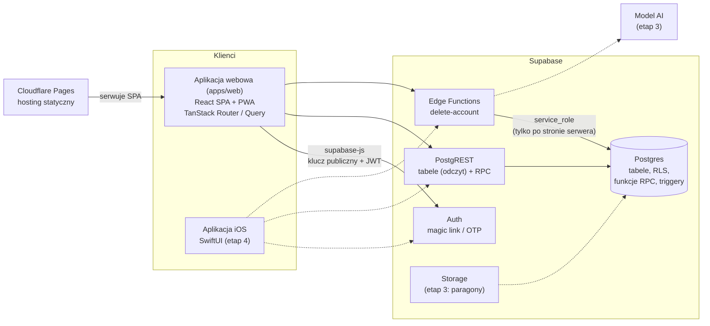
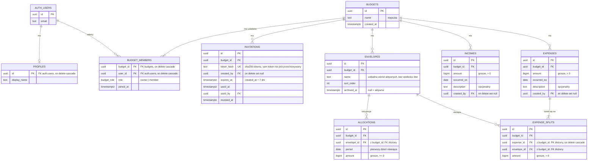

# Architektura

> **Status:** wersja do przeglądu (faza 0). Wymagania: [prd.md](prd.md). Uzasadnienia decyzji: [adr/](adr/). Model danych jest wstępny; ostateczny kształt każdej tabeli ustala specyfikacja w `.ai/specs/` przed jej migracją.

## 1. Komponenty



| Komponent | Odpowiedzialność |
|---|---|
| Aplikacja webowa | Prezentacja, nawigacja, formularze z walidacją dla wygody, wywołania RPC i zapytań przez TanStack Query. Brak reguł domenowych. |
| Supabase Auth | Konta i sesje (magic link / kod OTP), JWT z `auth.uid()` używanym przez RLS. |
| PostgREST | Odczyt tabel chronionych RLS i wywołania funkcji RPC. |
| Postgres | Jedyne miejsce reguł domenowych: ograniczenia, funkcje RPC, triggery, RLS. |
| Edge Functions | Operacje wymagające sekretów: w MVP tylko `delete-account` (usunięcie użytkownika z `auth.users` wymaga klucza `service_role`). |
| Cloudflare Pages | Hosting zbudowanej SPA (z przekierowaniem wszystkich ścieżek do `index.html`). |

## 2. Model danych



Kluczowe ograniczenia:

- Wszystkie tabele z danymi budżetu mają `budget_id` (`not null`, FK do `budgets` z `on delete cascade`) oraz `created_at` i `updated_at`.
- **Spójność budżetu przez klucze złożone:** `envelopes`, `expenses` mają unikalne `(id, budget_id)`; `allocations` i `expense_splits` odwołują się do nich przez `(envelope_id, budget_id)` i `(expense_id, budget_id)`. Baza uniemożliwia przypisanie wydatku lub przydziału do koperty z innego budżetu.
- `allocations`: `unique (envelope_id, period)`, `check (period = date_trunc('month', period)::date)` [Z1].
- `expense_splits`: `unique (expense_id, envelope_id)`; suma części = `expenses.amount` sprawdzana przez **odroczony trigger ograniczający** (`constraint trigger ... deferrable initially deferred`), więc reguła obowiązuje na końcu każdej transakcji, niezależnie od drogi zapisu.
- `envelopes`: indeks unikalny `(budget_id, lower(name)) where archived_at is null` [Z3].
- `budget_members`: każdy budżet ma co najmniej jednego właściciela – pilnują tego funkcje RPC zmieniające role i członkostwo (`set_member_role`, `remove_member`, `leave_budget`).
- Autor (`created_by`) wskazuje `auth.users` z `on delete set null`; usunięcie konta anonimizuje autorstwo, a interfejs pokazuje wtedy „Usunięty użytkownik”.
- `profiles.display_name` służy do pokazywania autora innym członkom (inni nie mają dostępu do `auth.users`). Domyślnie ustawiany przy pierwszym logowaniu (trigger na `auth.users`) na część adresu e-mail przed `@` – **do potwierdzenia**, patrz sekcja 6.

### Salda i pula (wyliczane, nieprzechowywane)

- **Pula** budżetu = `sum(incomes.amount) − sum(allocations.amount)` [Z2].
- **Saldo koperty na koniec miesiąca M** = `sum(allocations.amount where period <= M) − sum(expense_splits.amount where expenses.occurred_on < M + 1 miesiąc)`.
- Wyliczenia realizują funkcje SQL (sekcja 4), działające z uprawnieniami wywołującego (`security invoker`), więc podlegają RLS. Indeksy: `allocations (envelope_id, period)`, `expenses (budget_id, occurred_on)`, `expense_splits (envelope_id)`, `incomes (budget_id, occurred_on)`. Przy wolumenie gospodarstwa domowego (setki operacji miesięcznie) wyliczanie z historii jest wystarczająco szybkie; zmaterializowanie sald wymagałoby ADR.

## 3. Strategia RLS i dostępu

### Zasada ogólna

- **Odczyt:** bezpośrednio z tabel przez PostgREST, filtrowany politykami RLS `select`.
- **Zapis:** wyłącznie przez funkcje RPC. Tabele nie mają polityk `insert` / `update` / `delete`, a role `anon` i `authenticated` nie mają uprawnień zapisu (`revoke insert, update, delete`). Funkcje RPC są `security definer` z `set search_path = ''`, same sprawdzają `auth.uid()` i rolę w budżecie, a potem wykonują zapis w jednej transakcji. Uzasadnienie: [ADR 0003](adr/0003-business-logic-in-database.md).
- RLS jest włączone na wszystkich tabelach schematu `public` (także na tych bez polityk – wtedy dostęp jest zabroniony).

### Funkcje pomocnicze

```sql
-- security definer, stable, set search_path = '' – omija RLS na budget_members,
-- co zapobiega rekurencji polityk.
private.is_budget_member(p_budget_id uuid) returns boolean
private.is_budget_owner(p_budget_id uuid)  returns boolean
```

Obie porównują `budget_members.user_id` z `(select auth.uid())` (wywołanie w podzapytaniu, żeby Postgres liczył je raz na zapytanie). Leżą w schemacie `private`, niewystawionym przez PostgREST.

### Polityki per tabela

| Tabela | `select` | Zapis |
|---|---|---|
| `profiles` | własny profil oraz profile osób, z którymi użytkownik dzieli budżet | RPC `update_profile` |
| `budgets` | `is_budget_member(id)` | RPC (`create_budget`, `rename_budget`, `delete_budget`) |
| `budget_members` | `is_budget_member(budget_id)` | RPC (zaproszenia, role, usuwanie, opuszczanie) |
| `invitations` | `is_budget_owner(budget_id)` (kolumna `token_hash` niedostępna dla klientów) | RPC (`create_invitation`, `revoke_invitation`, `accept_invitation`) |
| `envelopes`, `incomes`, `allocations`, `expenses`, `expense_splits` | `is_budget_member(budget_id)` | RPC (sekcja 4) |

Osoba niezalogowana (`anon`) nie ma dostępu do żadnej tabeli ani funkcji RPC.

### Testy dostępu (pgTAP)

Dla każdej tabeli: członek budżetu A nie widzi i nie modyfikuje danych budżetu B; `member` nie wykonuje operacji zastrzeżonych dla `owner`; `anon` nie ma dostępu; bezpośredni `insert` / `update` / `delete` na tabeli jest odrzucany.

## 4. Operacje RPC

Konwencje: funkcje w schemacie `public`, nazwy `snake_case` w formie czasownik_rzeczownik, parametry z prefiksem `p_`, kwoty w groszach (`bigint`), miesiąc jako `date` (pierwszy dzień miesiąca). Błędy biznesowe zgłaszane przez `raise exception` ze stabilnym kodem w `message` (np. `ENVELOPE_ARCHIVED`), który klient mapuje na komunikat po polsku. Wszystkie funkcje wymagają zalogowanego użytkownika.

### Budżety i członkostwo

| Funkcja | Wejście | Wynik | Reguły | US |
|---|---|---|---|---|
| `create_budget` | `p_name text` | `uuid` | niepusta nazwa; wywołujący zostaje `owner` | US-04 |
| `rename_budget` | `p_budget_id`, `p_name` | `void` | tylko `owner` | US-06 |
| `delete_budget` | `p_budget_id` | `void` | tylko `owner`; kaskadowo usuwa dane | US-06 |
| `create_invitation` | `p_budget_id` | `(invitation_id uuid, token text, expires_at timestamptz)` | tylko `owner`; losowy token (`gen_random_bytes`), w bazie tylko jego hash; ważny 7 dni; token zwracany jednorazowo | US-07 |
| `revoke_invitation` | `p_invitation_id` | `void` | tylko `owner` budżetu zaproszenia | US-07 |
| `accept_invitation` | `p_token text` | `uuid` (budget_id) | token ważny, niezużyty, nieunieważniony; dołącza jako `member` i zużywa token; jeśli już członek – zwraca budżet bez zużycia | US-08 |
| `set_member_role` | `p_budget_id`, `p_user_id`, `p_role budget_role` | `void` | tylko `owner`; nie można odebrać roli ostatniemu właścicielowi | US-09 |
| `remove_member` | `p_budget_id`, `p_user_id` | `void` | tylko `owner`; nie można usunąć ostatniego właściciela | US-09 |
| `leave_budget` | `p_budget_id` | `void` | ostatni właściciel nie może opuścić budżetu | US-10 |
| `update_profile` | `p_display_name text` | `void` | niepusta nazwa | US-20 (autor) |

### Koperty

| Funkcja | Wejście | Wynik | Reguły | US |
|---|---|---|---|---|
| `create_envelope` | `p_budget_id`, `p_name` | `uuid` | członek; nazwa niepusta i unikalna wśród aktywnych; na końcu listy | US-11 |
| `rename_envelope` | `p_envelope_id`, `p_name` | `void` | członek; unikalność nazwy | US-12 |
| `reorder_envelopes` | `p_budget_id`, `p_envelope_ids uuid[]` | `void` | członek; lista musi zawierać dokładnie aktywne koperty budżetu | US-12 |
| `archive_envelope` | `p_envelope_id` | `void` | członek; saldo bieżące = 0 [Z4] | US-13 |
| `restore_envelope` | `p_envelope_id` | `void` | członek; unikalność nazwy wśród aktywnych | US-13 |

### Przychody, przydziały, wydatki

| Funkcja | Wejście | Wynik | Reguły | US |
|---|---|---|---|---|
| `create_income` | `p_budget_id`, `p_amount`, `p_occurred_on`, `p_description` | `uuid` | członek; kwota > 0; autor = wywołujący | US-14 |
| `update_income` | `p_income_id`, `p_amount`, `p_occurred_on`, `p_description` | `void` | członek; kwota > 0 | US-15 |
| `delete_income` | `p_income_id` | `void` | członek | US-15 |
| `set_allocation` | `p_envelope_id`, `p_period date`, `p_amount` | `void` | członek; kwota ≥ 0; koperta aktywna; `upsert` dla (koperta, miesiąc); brak limitu puli | US-16 |
| `create_expense` | `p_budget_id`, `p_amount`, `p_occurred_on`, `p_description`, `p_splits jsonb` (`[{envelope_id, amount}]`) | `uuid` | członek; kwota > 0; ≥ 1 część; części > 0; koperty aktywne i z tego budżetu, bez powtórzeń; suma części = kwota; atomowo | US-17, US-18 |
| `update_expense` | `p_expense_id`, jak wyżej bez `p_budget_id` | `void` | jak `create_expense`; części zastępowane w całości; do nowych części tylko aktywne koperty | US-19 |
| `delete_expense` | `p_expense_id` | `void` | członek; kaskadowo usuwa części | US-19 |

### Odczyty wyliczane (`security invoker`, `stable`)

| Funkcja | Wejście | Wynik | US |
|---|---|---|---|
| `get_unallocated` | `p_budget_id` | `bigint` | US-16, US-21 |
| `get_envelope_balances` | `p_budget_id`, `p_month date` | `table (envelope_id, name, sort_order, archived, balance bigint)` – saldo na koniec `p_month` | US-21 |
| `get_month_summary` | `p_budget_id`, `p_month date` | `table (envelope_id, name, opening_balance, allocated, spent, closing_balance)` dla kopert aktywnych lub używanych w miesiącu | US-22 |
| `get_month_totals` | `p_budget_id`, `p_month date` | `(income_total, allocated_total, unallocated)` | US-22 |

Lista operacji miesiąca (US-20) to zwykłe zapytania do `incomes` i `expenses` (z `expense_splits`, `envelopes`, `profiles`) przez PostgREST.

### Edge Functions

| Funkcja | Wejście | Reguły | US |
|---|---|---|---|
| `delete-account` | JWT użytkownika | [Z5]: odrzuca, jeśli użytkownik jest jedynym właścicielem budżetu z innymi członkami; usuwa budżety, w których jest jedynym członkiem; usuwa użytkownika z `auth.users` kluczem `service_role` (autorstwo wpisów zostaje zanonimizowane przez `on delete set null`) | US-03 |

## 5. Wersjonowanie i wsteczna zgodność API

Kontraktem API są: tabele i kolumny czytane przez klientów, sygnatury funkcji RPC, kody błędów biznesowych i Edge Functions. Starsze wersje aplikacji iOS mogą działać miesiącami po wydaniu nowej, więc:

- **Tylko zmiany addytywne:** nowe tabele, nowe kolumny (nullable lub z wartością domyślną), nowe funkcje, nowe opcjonalne parametry z wartością domyślną, nowe kody błędów.
- **Bez zmian łamiących w miejscu:** nie zmieniamy nazw ani typów kolumn, nie usuwamy kolumn ani funkcji, nie zmieniamy znaczenia istniejących parametrów ani wyników.
- **Nowa wersja zamiast zmiany:** gdy funkcja musi zmienić kontrakt, powstaje nowa z sufiksem wersji (np. `create_expense_v2`), a stara działa dalej (może stać się nakładką na nową).
- **Wycofywanie:** stary element jest oznaczany jako przestarzały (komentarz `comment on function ... is 'DEPRECATED: ...'` i wpis w ADR), a usuwany dopiero, gdy żadna wspierana wersja klienta go nie używa; usunięcie wymaga ADR i planu migracji.
- **Typy klienta** generowane z bazy (`supabase gen types typescript`) po każdej migracji; klient iOS będzie miał analogiczne modele.
- **Minimalna wspierana wersja klienta:** przed wydaniem aplikacji iOS dodamy mechanizm wymuszenia aktualizacji (np. tabela konfiguracji z minimalną wersją) – osobny ADR w etapie 4 rozwoju.
- Migracje są wersjonowane w repozytorium i nigdy nie są edytowane po zastosowaniu.

## 6. Otwarte kwestie architektoniczne

- **Nazwa wyświetlana autora:** PRD wymaga pokazywania autora operacji (US-20), ale nie określa, skąd pochodzi nazwa. Propozycja: domyślnie część adresu e-mail przed `@`, z możliwością zmiany (`update_profile`) – do decyzji, czy w MVP pytamy o nazwę przy pierwszym logowaniu.
